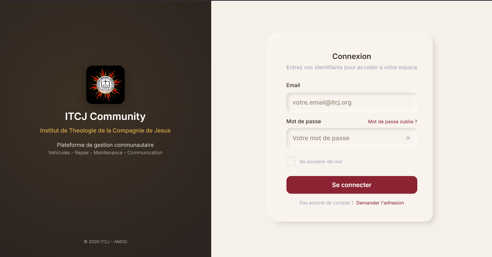
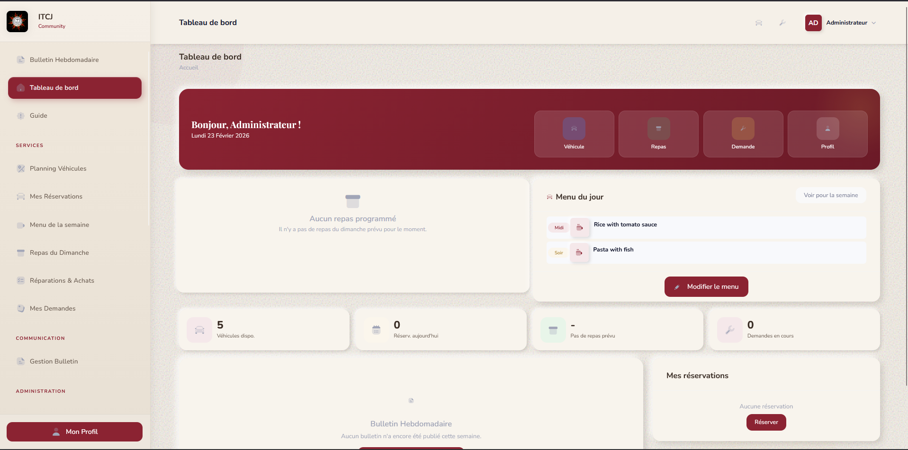
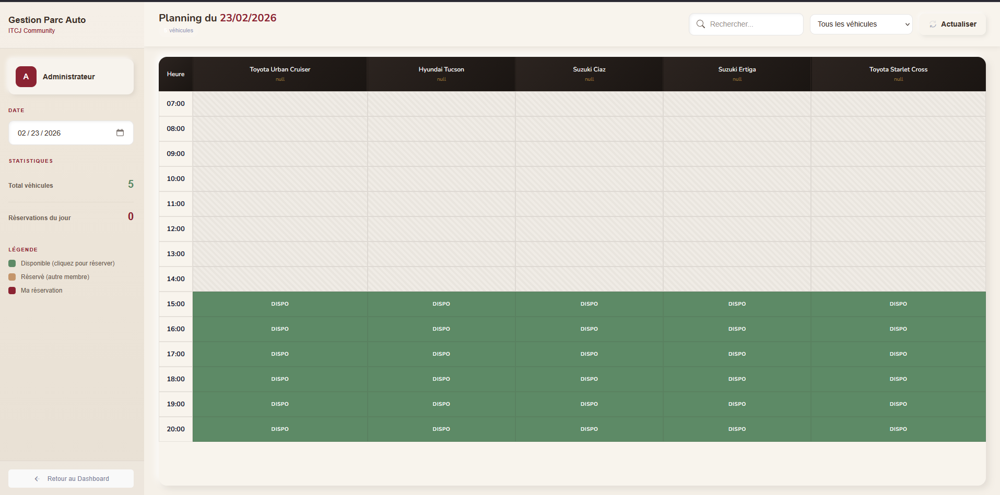
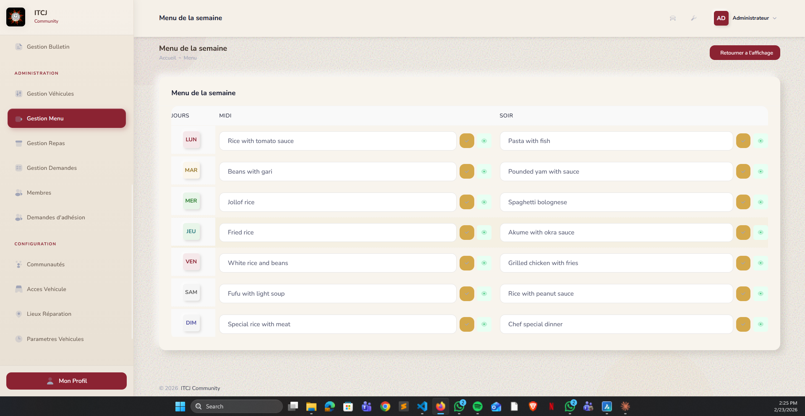
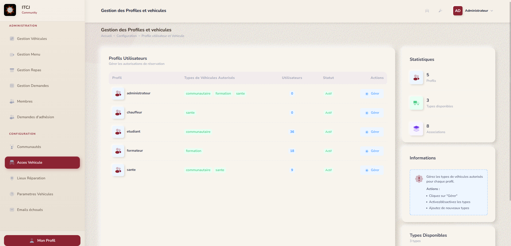

# Community App

<p align="center">
  <a href="#english">English</a> | <a href="#français">Français</a>
</p>


---

<a id="english"></a>

## English

Community management web application built with Laravel, designed to centralize the daily operations of a religious community: member management, vehicle reservations, Sunday meals, weekly bulletins, week menus, and community requests.

### Screenshots

| Login | Dashboard |
|:---:|:---:|
|  |  |

| Vehicle Reservations | Week Menu |
|:---:|:---:|
|  |  |

| Vehicle & Profile Management |
|:---:|
|  |

### Tech Stack

| Category | Technologies |
|---|---|
| **Backend** | Laravel 10, PHP 8.1+, MySQL |
| **Frontend** | Blade, Vite, Laravel Echo, Pusher.js |
| **Auth** | Laravel Sanctum + sessions |
| **PDF** | DomPDF (barryvdh/laravel-dompdf) |
| **Real-time** | Pusher + Laravel Broadcasting |
| **Code style** | Laravel Pint |
| **Tests** | PHPUnit 10 |

### Features

- **Member management**: creation, editing, profiles, roles (Admin, Communication, Member, Driver)
- **Vehicle reservations**: real-time planning with WebSockets, double-booking prevention
- **Sunday meals**: registrations, automatic generation for 4 weeks ahead, automatic Saturday closure
- **Weekly bulletins**: editing, publishing, automatic numbering per year
- **Week menus**: management by day and period (lunch/dinner), dynamic dashboard display
- **Community requests**: repairs and purchases with QR code generation
- **Guide**: help module and internal documentation
- **Email notifications**: safe sending with failure logging (`failed_emails` table)

### Installation

#### Prerequisites

- PHP 8.1+
- Composer
- Node.js & npm
- MySQL
- (Optional) Pusher for real-time features

#### Setup

```bash
# Clone the repository
git clone https://github.com/Dreykovic/community_app.git
cd community_app

# Install dependencies
composer install
npm install

# Configure environment
cp .env.example .env
php artisan key:generate

# Configure database in .env
# DB_DATABASE=community_app
# DB_USERNAME=root
# DB_PASSWORD=your_password

# Run migrations and seeders
php artisan migrate --seed

# Build assets
npm run build

# Start the server
php artisan serve
```

#### Development

```bash
# Server + hot reload (2 terminals)
php artisan serve
npm run dev

# Run tests
php artisan test

# Format code
./vendor/bin/pint

# Clear caches
php artisan optimize:clear
```

### Project Structure

```
app/
├── Enums/           # PlatformRole (custom JSON-based role system)
├── Events/          # Broadcasting (ReservationCreated, MealInscriptionChanged...)
├── Http/
│   ├── Controllers/ # Controllers by module (Bulletin, Meal, Vehicle...)
│   │   └── Admin/   # Administration controllers
│   └── Middleware/   # CheckRole (role-based authorization)
├── Models/          # Eloquent models (User, Vehicle, SundayMeal, WeekMenu...)
├── Services/        # SundayMealService (business logic)
└── Traits/          # SafeMailSender (safe email sending)

resources/
├── views/           # Blade templates by module
│   ├── layouts/     # Main layouts
│   ├── dashboard/   # Dashboard
│   ├── bulletin/    # Weekly bulletins
│   ├── meals/       # Meal management
│   ├── reservations/# Vehicle planning
│   └── ...
├── js/              # Echo/Pusher setup, Axios config
└── css/             # Styles

routes/
├── web.php          # Web routes (guest + auth + admin)
├── api.php          # API v1 (polling fallback for real-time)
└── channels.php     # Broadcasting channels
```

### Author & Impact

This project was designed and developed by **[@Dreykovic](https://github.com/Dreykovic)** to address the real management needs of a religious community. It replaces manual processes (spreadsheets, phone calls, paper notices) with a centralized web platform accessible to all members.

**Impact**:
- Streamlined coordination of meals and vehicles
- Reduced booking conflicts through real-time updates
- Centralized communication via weekly bulletins
- Full traceability of repair and purchase requests

### License

This project is private. All rights reserved.

---

<a id="français"></a>

## Français

Application web de gestion communautaire construite avec Laravel, permettant de centraliser les operations quotidiennes d'une communaute religieuse : gestion des membres, reservations de vehicules, repas du dimanche, bulletins hebdomadaires, menus de la semaine et demandes communautaires.

### Captures d'ecran

| Connexion | Tableau de bord |
|:---:|:---:|
|  |  |

| Reservations vehicules | Menu de la semaine |
|:---:|:---:|
|  |  |

| Gestion vehicules et profils |
|:---:|
|  |

### Stack technique

| Categorie | Technologies |
|---|---|
| **Backend** | Laravel 10, PHP 8.1+, MySQL |
| **Frontend** | Blade, Vite, Laravel Echo, Pusher.js |
| **Auth** | Laravel Sanctum + sessions |
| **PDF** | DomPDF (barryvdh/laravel-dompdf) |
| **Temps reel** | Pusher + Laravel Broadcasting |
| **Code style** | Laravel Pint |
| **Tests** | PHPUnit 10 |

### Fonctionnalites

- **Gestion des membres** : creation, edition, profils, roles (Admin, Communication, Membre, Chauffeur)
- **Reservations de vehicules** : planning temps reel avec WebSockets, prevention des doubles reservations
- **Repas du dimanche** : inscriptions, generation automatique sur 4 semaines, cloture automatique le samedi
- **Bulletins hebdomadaires** : edition, publication, numerotation automatique par annee
- **Menus de la semaine** : gestion par jour et periode (midi/soir), affichage dynamique sur le dashboard
- **Demandes communautaires** : reparations et achats avec generation de QR codes
- **Guide** : module d'aide et documentation interne
- **Notifications email** : envoi securise avec log des echecs (table `failed_emails`)

### Installation

#### Prerequis

- PHP 8.1+
- Composer
- Node.js & npm
- MySQL
- (Optionnel) Pusher pour le temps reel

#### Mise en place

```bash
# Cloner le repository
git clone https://github.com/Dreykovic/community_app.git
cd community_app

# Installer les dependances
composer install
npm install

# Configurer l'environnement
cp .env.example .env
php artisan key:generate

# Configurer la base de donnees dans .env
# DB_DATABASE=community_app
# DB_USERNAME=root
# DB_PASSWORD=votre_password

# Lancer les migrations et seeders
php artisan migrate --seed

# Compiler les assets
npm run build

# Lancer le serveur
php artisan serve
```

#### Developpement

```bash
# Serveur + hot reload (2 terminaux)
php artisan serve
npm run dev

# Lancer les tests
php artisan test

# Formatter le code
./vendor/bin/pint

# Vider les caches
php artisan optimize:clear
```

### Structure du projet

```
app/
├── Enums/           # PlatformRole (systeme de roles custom JSON)
├── Events/          # Broadcasting (ReservationCreated, MealInscriptionChanged...)
├── Http/
│   ├── Controllers/ # Controllers par module (Bulletin, Meal, Vehicle...)
│   │   └── Admin/   # Controllers d'administration
│   └── Middleware/   # CheckRole (autorisation par role)
├── Models/          # Eloquent models (User, Vehicle, SundayMeal, WeekMenu...)
├── Services/        # SundayMealService (logique metier)
└── Traits/          # SafeMailSender (envoi email securise)

resources/
├── views/           # Templates Blade par module
│   ├── layouts/     # Layouts principaux
│   ├── dashboard/   # Tableau de bord
│   ├── bulletin/    # Bulletins hebdomadaires
│   ├── meals/       # Gestion des repas
│   ├── reservations/# Planning vehicules
│   └── ...
├── js/              # Echo/Pusher setup, Axios config
└── css/             # Styles

routes/
├── web.php          # Routes web (guest + auth + admin)
├── api.php          # API v1 (polling fallback pour le temps reel)
└── channels.php     # Canaux de broadcasting
```

### Auteur et impact

Ce projet a ete concu et developpe par **[@Dreykovic](https://github.com/Dreykovic)** pour repondre aux besoins concrets de gestion d'une communaute religieuse. Il remplace des processus manuels (tableurs, appels telephoniques, affichages papier) par une plateforme web centralisee, accessible a tous les membres.

**Impact** :
- Simplification de la coordination des repas et des vehicules
- Reduction des conflits de reservation grace au temps reel
- Communication centralisee via les bulletins hebdomadaires
- Tracabilite des demandes de reparation et d'achat

### Licence

Ce projet est prive. Tous droits reserves.


